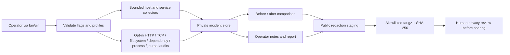

<div align="center">

# Ubuntu Incident Response Toolkit

**Investigate the symptom. Preserve the evidence. Explain the recovery.**

A local, least-privilege **Bash incident-triage CLI** for Ubuntu 24.04 LTS. Capture bounded diagnostics, compare immutable before/after evidence, document decisions, and prepare reviewable handoff archives.

`Bash` · `systemd` · `journalctl` · `jq` · `curl` · `ss` · `gzip` · `SHA-256` · `Bats`

**Status: v1.0 release candidate — 13 automated stages passed on Ubuntu 24.04 / WSL 2; final publication and manual privacy review pending.**

[Quick start](#quick-start) · [CLI workflow](#a-complete-incident-workflow) · [Diagnostics](#opt-in-diagnostic-collectors) · [Testing](#testing-and-evidence) · [Security](#security-and-limitations) · [Runbooks](#incident-scenarios) · [Release checklist](docs/release-checklist.md)

</div>

---

## Why it exists

Linux incident triage often scatters evidence across `systemctl`, journals, network sockets, filesystem measurements, process listings, application checks and ticket notes. UIR creates a **repeatable local workflow**: register the incident, collect a time-bounded **before** snapshot, perform a human-reviewed correction, capture **after**, compare observed changes, and prepare an integrity-checked handoff.

UIR deliberately **does not fix incidents for you**. It is an educational support-engineering portfolio project—not a commercial monitoring system, a forensic evidence platform, a Canonical product, or a claim of production support experience.

## Features at a glance

| Area | Implemented capability |
| --- | --- |
| Triage | Ubuntu/WSL preflight, explicit service profiles, bounded host/service diagnostics |
| Case management | Persistent incident ID, severity, status, UTC timestamps and typed operator notes |
| Evidence | One immutable `before` and `after` capture per incident, compressed diagnostics and scoped journal excerpts |
| HTTP health (**H01**) | Opt-in localhost `GET /` probe; response status, outcome, duration and timeout, no response body |
| TCP listener (**H02**) | Opt-in port/bind-address observation; a listener is not proof of application health |
| Filesystem (**H03**) | Opt-in target mount size, free bytes, inode measurements; stores target-path fingerprint, not raw path |
| systemd dependencies (**H04**) | Opt-in inspection of up to eight direct `Requires=` units, observed states and `After=` relationship |
| Process sample (**H05**) | Opt-in ranked sample of up to eight processes; names and resource values, no command-line arguments |
| Journal visibility (**H06**) | Opt-in scoped journal *metadata* counts and transport classification; no message content in audit metadata |
| Evidence workflow | Literal search, structured comparison, Markdown report and previewable redacted `.tar.gz` export |
| Safeguards (**H07**) | Restricted local store, command bounds, overwrite refusal, decompressed-byte checks, SHA-256 manifest |
| Retention | Configurable limits, explicit dry-run and confirmed pruning; never automatic |

Every optional probe is **read-only**. A successful *collector* can record an unhealthy endpoint or absent listener. A `partial` capture means at least one collector had limited or failed execution; it must not be silently relabeled `complete`.

## Architecture



See [architecture and evidence contract](docs/architecture.md), [operator handbook](docs/operations.md), and [security boundaries](docs/security.md).

## Platform and prerequisites

- **Target:** Ubuntu 24.04 LTS with Bash 5 and systemd. **Environment actually exercised:** Ubuntu 24.04 on **WSL 2**, using isolated, non-disruptive lab services and synthetic fixtures. Native Ubuntu Server and Oracle VirtualBox acceptance were **not performed**.
- **CLI runtime:** `bash`, `jq`, GNU coreutils, `tar`, `gzip`, `timeout`, `flock`, `sha256sum`, `ip`, `ss`, `systemctl`, `journalctl`; `curl` for HTTP probes and `ps` for process probes.
- **Development checks:** `shellcheck`, `shfmt`, `bats`; `python3` is needed by selected test fixtures, not the core CLI.
- **Profile-specific tools:** Nginx and OpenSSH are optional, necessary only for their respective service exercises.

On Ubuntu 24.04, install the common dependencies, then run preflight:

```bash
sudo apt update
sudo apt install -y bash jq coreutils tar gzip iproute2 curl procps python3 shellcheck shfmt bats
./bin/uir --version
./bin/uir doctor
```

The repository may be edited under `/mnt/c` in WSL 2; the **private incident store must remain on the Linux filesystem** (default `~/.local/share/ubuntu-irt/`), not in a shared Windows folder. Do not run `sudo ./bin/uir`. Never inject failures into a work host or your primary WSL networking, firewall, package database or disk; use the documented isolated training approach.

## Quick start

From the repository root (no external install or daemon required):

```bash
chmod +x bin/uir
./bin/uir --help
./bin/uir doctor
./bin/uir init
./bin/uir incident create --id INC-101 --service host --severity low \
  --summary "Read-only host diagnostic demonstration"
./bin/uir capture --incident INC-101 --phase before --minutes 5 \
  --fs-path / --processes
```

**Use a new incident ID:** snapshots are immutable. This example records observations only; it does not manufacture an outage. If using `INC-101` already, choose another unused ID. Inspect the JSON at `~/.local/share/ubuntu-irt/incidents/INC-101/before/snapshot.json`.

## A complete incident workflow

The commands below show how an operator records a **disposable Nginx training incident**. Create a fresh ID, and only run the after capture after you have independently verified recovery. Fault reproduction and remediation are **manual** and are not executed by the CLI.

```bash
./bin/uir incident create --id INC-102 --service nginx --severity medium \
  --summary "Isolated Nginx training service investigation"
./bin/uir incident status --id INC-102 --value investigating

# Capture the observed failure (or baseline); HTTP and listener checks are opt-in.
./bin/uir capture --incident INC-102 --phase before --minutes 5 \
  --http-port 18080 --listen-port 18080 --expect-address 127.0.0.1 \
  --dependencies --journal-audit

# Investigate, verify, and manually correct a disposable isolated fault.
./bin/uir incident note --id INC-102 --kind root_cause \
  --text "Document only a cause supported by separate evidence"
./bin/uir incident note --id INC-102 --kind remediation \
  --text "Document the reviewed manual change and rollback"

# Use the same opt-in checks in both phases to make meaningful comparisons.
./bin/uir capture --incident INC-102 --phase after --minutes 5 \
  --http-port 18080 --listen-port 18080 --expect-address 127.0.0.1 \
  --dependencies --journal-audit
./bin/uir compare --incident INC-102
./bin/uir incident note --id INC-102 --kind verification \
  --text "Record an independently observed functional check"
./bin/uir incident status --id INC-102 --value resolved
./bin/uir report --incident INC-102
./bin/uir export --incident INC-102 --preview
# Export into a private location OUTSIDE the Git checkout, after reviewing preview.
./bin/uir export --incident INC-102 --output "$HOME/INC-102-handoff.tar.gz"
```

The default Nginx collector runs an unprivileged configuration check. In WSL 2, `nginx -t` may report `permission_limited` due to `/run/nginx.pid`, even when Nginx is running; the snapshot correctly remains **partial**. Independently verify with `sudo nginx -t` if appropriate, but never run the entire toolkit as root.

## Opt-in diagnostic collectors

All flags belong to `./bin/uir capture`, **not** standalone shell commands.

| Flag | Recorded observation | Important interpretation |
| --- | --- | --- |
| `--http-port 18080` | `http_probe` (GET `http://127.0.0.1:18080/` only) | HTTP 4xx/5xx is a valid observation; a network timeout is not a status code |
| `--listen-port 18080` | `tcp_listener` with bound addresses | Host-level socket visibility, not process ownership |
| `--expect-address 127.0.0.1` | Expected bind-address check | Requires `--listen-port`; supported loopback addresses are restricted |
| `--fs-path /` | `filesystem`: containing mount capacity/inodes and target hash | Filesystem usage, **not directory size**; raw path omitted from snapshot |
| `--dependencies` | `dependencies`: at most 8 direct `Requires=` units | Service profile only; observed state and ordering do not prove causality |
| `--processes` | `processes`: up to 8 process names and resource measurements | `ps` CPU percentage is a **lifetime average**, not instantaneous CPU |
| `--journal-audit` | `journal_audit`: scoped entry counts and transport summary | Service profile only; no entries observed does not prove failed logging |

To check a saved snapshot:

```bash
jq '{capture_status, collector_results, http_probe, tcp_listener, filesystem,
     dependencies, processes, journal_audit}' \
  "$HOME/.local/share/ubuntu-irt/incidents/INC-102/before/snapshot.json"
```

Use `./bin/uir --help` for the definitive installed syntax. Probe results appear as optional JSON objects; absent options are not silently tested.

## Private records, search and retention

```text
~/.local/share/ubuntu-irt/
├── config/settings.json
└── incidents/INC-102/
    ├── incident.json
    ├── before/{snapshot.json,diagnostics.txt.gz,journal.jsonl.gz}
    ├── after/{snapshot.json,diagnostics.txt.gz,journal.jsonl.gz}
    ├── comparison.json
    └── report.md
```

The private incident store uses owner-only permissions. Its logs and reports **may still contain sensitive information** despite best-effort redaction; never commit the store into Git.

```bash
./bin/uir incident list
./bin/uir incident show INC-102
./bin/uir incident search --text 'connection refused'
./bin/uir retention status
./bin/uir retention set --days 30 --max-storage-mb 500 --capture-max-mb 10
./bin/uir retention prune --dry-run
# Inspect all deletion candidates. Explicit confirmation only:
./bin/uir retention prune --yes
```

Defaults are 30 days, 500 MiB managed incident storage and 10 MiB per compressed capture. Retention has **no background job**, and exported handoffs are outside its scope.

## Secure export and manual review

`export --preview` performs safety checks without writing a handoff. The export process stages allowlisted files, applies public sanitization, enforces decoded-data bounds, generates a Markdown report from sanitized metadata and adds an internal SHA-256 manifest. Export refuses to overwrite an existing destination.

**Hashes verify archive consistency, not authenticity or anonymity.** Check the member list for traversal/symlinks **before** extracting into a private empty directory; then verify checksums and manually inspect every text, JSON and decompressed journal/diagnostic file. Automated redaction is incomplete by design. **Do not publish real incident exports, internal hostnames, credentials or private logs.** See [security](docs/security.md) and [release checklist](docs/release-checklist.md).

## Testing and evidence

```bash
bash tests/run-all.sh
printf 'Regression exit: %s\n' "$?"
```

The **November 14, 2026 WSL 2 acceptance run** reported **13/13 stages** and exit code `0`, including 28 original end-to-end integration checks, H01–H06 integration, and H07 archive-boundary/privacy tests. A subsequent log search showed only the runner's generic `SKIP` reminder, not an actual skipped-check line. This is **local automated acceptance**, not an independent penetration test or production certification. A clean checkout and manual release privacy review remain required. See [testing matrix](docs/testing.md).

## Incident scenarios

Twelve training scenarios were **exercised in WSL 2**, using isolated disposable units/services and explicit synthetic fixtures where warranted. They were **not** VirtualBox or production incidents. An operator's terminal screenshots showed before/after captures, reports, export verification and cleanup for the exercises; the original private evidence bundles are not included here.

| Scenario | Investigation focus | Reference KB |
| --- | --- | --- |
| INC-001 | Failed systemd `ExecStart` | [KB-001](docs/kb/KB-001.md) |
| INC-002 | Isolated SSH configuration error | [KB-002](docs/kb/KB-002.md) |
| INC-003 | Nginx content file permissions | [KB-003](docs/kb/KB-003.md) |
| INC-004 | APT lock message **(synthetic fixture)** | [KB-004](docs/kb/KB-004.md) |
| INC-005 | Bounded CPU workload; non-causal load samples | [KB-005](docs/kb/KB-005.md) |
| INC-006 | Capped `tmpfs` exhaustion | [KB-006](docs/kb/KB-006.md) |
| INC-007 | Invalid Nginx configuration | [KB-007](docs/kb/KB-007.md) |
| INC-008 | Reverse proxy upstream unavailable | [KB-008](docs/kb/KB-008.md) |
| INC-009 | Isolated DNS timeout | [KB-009](docs/kb/KB-009.md) |
| INC-010 | Loopback address reachability / synthetic firewall evidence | [KB-010](docs/kb/KB-010.md) |
| INC-011 | Discarded application stdout/stderr | [KB-011](docs/kb/KB-011.md) |
| INC-012 | Required systemd dependency failure | [KB-012](docs/kb/KB-012.md) |

See the [evidence-status tracker](docs/incidents/STATUS.md) for the exact scope and outstanding verification limits. Historical plans in `docs/planning/` and early milestone notes capture decisions made **before** the WSL 2 execution strategy; they are not current release-status statements.

## Security and limitations

UIR is local and user-invoked: **no `sudo` inside the CLI, auto-remediation, telemetry, remote collection, background monitoring, dashboard or GUI**. It cannot guarantee complete journal visibility, accurate attribution of resource spikes, identification of every secret, race-free handling against a hostile same-UID process, or native-VM behavior from WSL-only tests.

For responsible use see [SECURITY.md](SECURITY.md), [security model](docs/security.md), [contributing](CONTRIBUTING.md), and [operator guide](docs/operations.md).

## License and release status

[MIT License](LICENSE). Maintained as a learning and engineering portfolio project; **not affiliated with Canonical**. Version in `lib/config.sh` remains `1.0.0-rc1` until the final clean-checkout and privacy gates are approved. The planned v1.0.0 tag and GitHub publication are **not yet claimed**.
