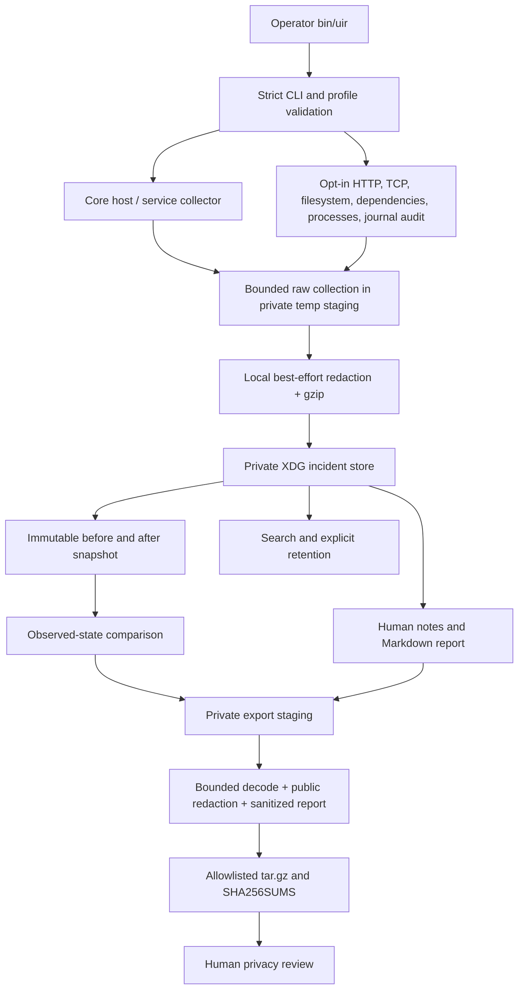

# Architecture and evidence contract

**Current phase:** v1.0 release candidate (CLI version `1.0.0-rc1`). **Target:** Ubuntu 24.04 LTS. **Verified:** Ubuntu 24.04 on WSL 2. **Execution:** unprivileged, local, manually invoked; no monitoring daemon or automatic repair.

## Scope and design decisions

1. **Explicit profiles.** `host`, `nginx`, `ssh`, `ssh.socket` and disposable `uir-*` service names; arbitrary command execution is not exposed through the CLI.
2. **Read-only probes.** Core host and service state; opt-in `http_probe`, `tcp_listener`, `filesystem`, `dependencies`, `processes`, and `journal_audit`. HTTP is fixed to `GET /` at `127.0.0.1`; TCP inspects host listeners, not ownership. Dependencies inspect at most eight direct `Requires=` units and their `After=` relation. Process results omit full arguments. Journal audit records metadata counts without `MESSAGE` text.
3. **Private state.** `$XDG_DATA_HOME/ubuntu-irt` or `~/.local/share/ubuntu-irt`, with checked permissions and paths. Root CLI execution is refused. Temporary staging and locking support cooperating writes; snapshot directories are immutable after publication.
4. **Bounded work.** Time-bounded subprocesses, selected service journals with a limited time window/record count, compressed evidence caps and decoded-byte limits on export. Bounds are not an adversarial, kernel-enforced memory or CPU quota.
5. **Truthful incompleteness.** `capture_status: partial` when collector execution is limited. Separate collector exit statuses let an operator distinguish, for example, a successful HTTP probe *observing an error* from a failed probe mechanism. A WSL Nginx `nginx -t` can remain `permission_limited` when executed as a normal user.
6. **No root-cause invention.** Comparison records before/after observations. Mismatched targets and failed observations have explicit non-comparability rules. Operator notes—not the diff—supply hypothesis, root cause, remediation and verification.
7. **Public handoff boundary.** Export constructs fixed-format membership from a private stage. H07 enforces decompressed-byte bounds even for concatenated gzip input, removes selected network/host identifiers from public snapshots, and creates the public report from sanitized metadata. The generated `SHA256SUMS` is an **integrity check**, not a digital signature or a promise of anonymity.

## Data contract

- `incident.json` — `schema_version`, `incident_id`, selected service, severity, status, summary, UTC times, notes and capture metadata.
- `before/snapshot.json` and `after/snapshot.json` — `schema_version: 1`, phase, `capture_status`, `collector_results`, `host`, `service`, and optional `http_probe`, `tcp_listener`, `filesystem`, `dependencies`, `processes`, `journal_audit` objects. When an opt-in probe is absent its JSON object is `null`.
- `diagnostics.txt.gz` — bounded locally redacted text; may still contain sensitive material.
- `journal.jsonl.gz` — bounded, unit-scoped journal excerpt for service profiles; can be empty or inaccessible. This is **separate** from journal-audit metadata.
- `comparison.json` — structured observation pairs and comparability booleans (`http_target_comparable`, `tcp_target_comparable`, `filesystem_target_comparable`, etc.), with a causality caution.
- `report.md` — snapshot summary and human notes; no automatically asserted RCA.
- Export `SHA256SUMS` — checksums of allowlisted handoff members. The manifest is inside the archive and does not authenticate the publisher.

## Trust model and limits

The toolkit assumes a trusted local UNIX user and is not hardened against a malicious process with the **same UID** racing filesystem prechecks. It does not offer tamper-evident custody, digital signatures, enterprise monitoring, or production qualification. User-configured paths must be private Linux paths for runtime data; Windows-mounted directories may have differing ownership semantics. Automated text-pattern redaction is not a completeness guarantee. The WSL 2 validation described in [testing](testing.md) is **not** native Ubuntu/VirtualBox acceptance. See [security](security.md) and the [release checklist](release-checklist.md).
