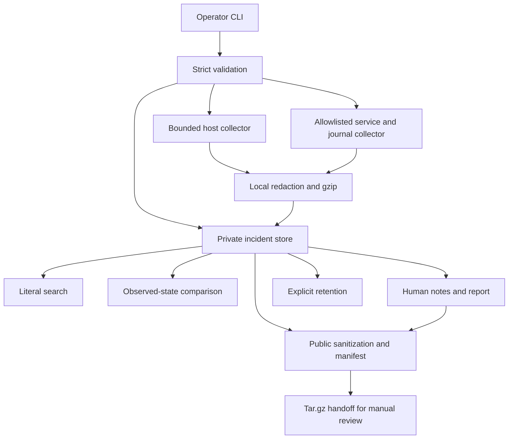

# Architecture and evidence contract

**Release candidate:** v1.0.0-rc1 · **platform:** Ubuntu 24.04 LTS · **execution:** regular user, local machine · **scope:** no automatic remediation and no background service.

## Trust boundaries

1. User-supplied incident IDs are restricted to `INC-` plus three to six digits. Service names have a restricted syntax, and **capture profiles** are further allowlisted to `host`, `nginx`, `ssh`, `ssh.socket` and `uir-*` disposable units.
2. Shell never `eval`s, sources, or interpolates collected log text into executable commands. All calls use fixed executables and quoted arguments.
3. The runtime store is outside the checkout: `$XDG_DATA_HOME/ubuntu-irt` or `~/.local/share/ubuntu-irt`. It is owned by the executing user. The application checks `0700` directories, `0600` files and rejects symlinks in relevant paths.
4. `capture` can run in the user's context without `sudo`; unavailable journals are reported as **partial** results. The `host` profile intentionally does not run an unrestricted whole-host journal query.
5. Collection is **bounded**: timeouts for system calls, log entry limit (300), recent time window (1–60 minutes), shell file-size limits, one immutable capture per phase, and configured per-capture/total storage ceilings. The Bash implementation cannot promise hard wall-to-wall memory caps.
6. Local captured text is passed through a limited regex redactor before gzip storage. An additional public redactor masks common emails, IPv4 addresses, home path identifiers and seeded patterns. **Neither is a secret scanner with a completeness guarantee**; a human must inspect releases.
7. Archive members are assembled from an explicit allowlist in a newly created private staging directory. A manifest of SHA-256 file digests is added. An archive is written only to a new path, without clobbering an existing file.
8. Retention cleanup always requires `--yes`; a separate `--dry-run` presents the same selection. Cleanup is constrained to incident ID directories; exports are out of scope.

## JSON schema (v1)

- `incident.json`: `schema_version: 1`, `incident_id`, `service`, `severity`, `status`, `summary`, UTC timestamps, bounded array of dated operator notes, capture references.
- `{before,after}/snapshot.json`: `schema_version`, `incident_id`, `phase`, UTC timestamp, `capture_status` (`complete` or `partial` in this implementation), `collector_results`, `host` and `service` observations.
- `comparison.json`: before/after UTC timestamps and structured observed differences. **It does not infer root cause**.
- `{before,after}/diagnostics.txt.gz`: bounded text outputs from read-only diagnostic commands; secrets may remain.
- `{before,after}/journal.jsonl.gz`: bounded journal excerpt for a single allowlisted service; can be empty if no logs accessible.
- `report.md`: human-friendly handoff assembled from captured snapshots and notes. It never fills in unspecified RCA.
- Export `SHA256SUMS`: manifest of files *inside* the archive; verify with `sha256sum -c SHA256SUMS` after safe extraction.

## Known architectural constraints

The tool is designed for use by the same trusted local UNIX user who owns the evidence. Bash path prechecks cannot guarantee race-free behavior against hostile processes running as the **same UID**. The collector never escalates privilege, cannot guarantee access to all journal records, and does not currently capture arbitrary additional ports or run custom network probes. For the Nginx 502 incident, the operator must record the observed `curl` verification separately. Do not use as an enterprise SIEM, a replacement for backup, or a security-audited forensics platform.
